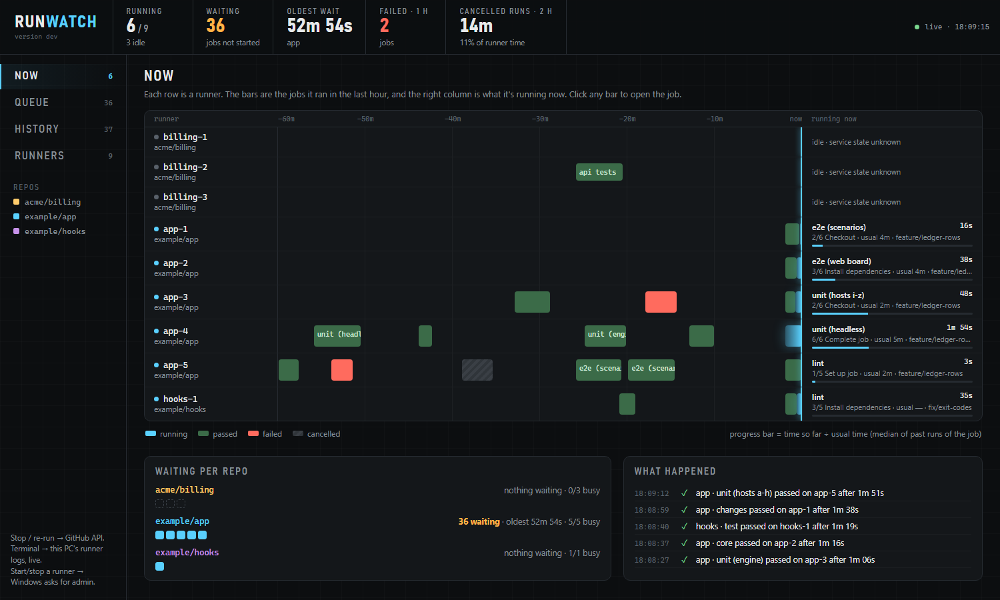
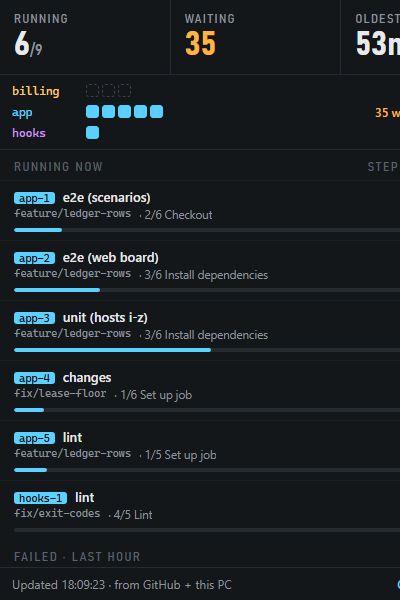

# Runwatch

A Windows tray app that watches the GitHub Actions self-hosted runners installed on your PC.

It answers the questions you otherwise open five GitHub tabs for: which runners are busy, what is waiting and
for how long, what failed, and what a job is printing right now. From the same place you can stop a run and
re-run jobs.



- **Tray icon**: blue while jobs run, amber once something has waited more than 15 minutes, a red dot when a
  job failed in the last hour.
- **Flyout** (left click): the three numbers that matter, one row per repo, and every running job with its
  step, time so far and usual time. Click a job to see its output. Stop asks for confirmation in place.
- **Dashboard** (in your browser, served on `127.0.0.1`): a one-hour timeline per runner, the queue, the
  history, the runners, and a full terminal per job.
- **Notifications**: only when a job fails or a run has waited more than 45 minutes.

Everything shown is a fact read from GitHub or from the runner's own files. There are no estimates: progress
is "step 3 of 6, 4m 10s so far, usually 6m" (the median of the last 20 successful runs of that job).



## Try it in one minute (no runners needed)

The demo runs the real app on made-up runners and a pretend GitHub that keeps moving. It touches nothing
real: no token, no network, no runner.

```
runwatch.exe --demo
```

Then look for the three-bar icon in the tray. Windows puts new icons in the hidden-icons overflow (the `^`
arrow); drag it onto the taskbar to keep it visible. The dashboard is at <http://127.0.0.1:7878>.

## Requirements

- Windows 10 or 11 with the WebView2 runtime (part of Windows 11; on Windows 10 it comes with Edge).
- GitHub Actions self-hosted runners installed on the PC **for repositories** (see [limits](#limits)), or
  use the demo above.
- The [GitHub CLI](https://cli.github.com) logged in (`gh auth login`) with an account that can see each
  repo's Actions. Runwatch asks `gh` for the token; it never stores one. If you use several accounts
  (`gh auth login` more than once), Runwatch picks, per repo, the first account that can read it.

## Install

**Download** `runwatch-<version>-windows.zip` from the
[latest release](https://github.com/diegofal/runwatch/releases/latest), unzip it anywhere, and run
`runwatch.exe`. Windows may warn that the program is not signed: choose **More info**, then **Run anyway**.

Or **build it** (Go 1.26 and [Task](https://taskfile.dev)):

```
git clone https://github.com/diegofal/runwatch
cd runwatch
task build          # bin\runwatch.exe
bin\runwatch.exe
```

First start, step by step:

1. Make sure `gh auth status` shows an account that can see your repos' Actions.
2. Run `runwatch.exe`. Find the three-bar icon under the tray's `^` arrow and drag it onto the taskbar.
3. Left-click it. Your runners should be listed. If a red bar appears instead, it says what could not be
   read; [Troubleshooting](docs/TROUBLESHOOTING.md) has each message.
4. Right-click the icon and tick **Start at login** to keep it running.

Runwatch finds the runners by itself: it lists the Windows services named `actions.runner.*` and reads each
one's folder. No configuration is needed for the usual setup. Runners that are not installed as services are
found by adding their parent folder to `roots` in the [configuration](docs/CONFIGURATION.md). If some of
your runners are started and stopped by another tool, list them under `managed` there so Runwatch does not
offer to.

## Using it

| You want to | Do this |
|---|---|
| See what is running | Left-click the tray icon, or open the dashboard's **Now** tab |
| Watch a job's output | Click the job (flyout: last lines; dashboard: full terminal with find and follow) |
| See why things are slow | Dashboard, **Queue**: runs with jobs that have not started, oldest first |
| Stop a run | **stop** on the job or the queue row, then confirm. See the note below. |
| Re-run a failed job | **re-run** on the failed row (flyout, History) or in the job's panel |
| Re-run everything that failed in a run | Open one of its jobs, **re-run failed jobs** |
| Start or stop a runner | Dashboard, **Runners**. Windows asks for admin. |
| See where the disk went | Dashboard, **Runners**: size of each runner's logs and checkouts |

**Stopping cancels the whole run.** GitHub has no way to cancel one job, so "stop" cancels every unfinished
job of that run, including jobs on GitHub's own machines. The confirmation says how many.

More screenshots: [queue](docs/img/dashboard-queue.png), [history](docs/img/dashboard-history.png),
[runners](docs/img/dashboard-runners.png), [a job's terminal](docs/img/dashboard-job.png).

## Limits

These are facts about GitHub and the runner, not things left undone:

- **Stop is per run**, as above.
- **Live output is best effort.** While a job runs, its output is read from the runner's own files. The
  runner writes them a few KB at a time and deletes each block once uploaded, so a quiet step shows nothing
  for a while, and output printed before Runwatch started is not available until the job ends. Once a job
  ends, the terminal shows the whole log from GitHub.
- **Repository runners only.** A runner registered to an organization serves many repos; Runwatch lists it
  with a problem message instead of guessing which repos to ask about.
- **Re-run needs the run to be finished.** GitHub refuses to re-run a job while its run still has jobs
  going; Runwatch shows GitHub's message.
- **One PC.** It watches the runners of the machine it runs on.
- **Windows.** The core is portable Go, but service discovery, notifications and the tray are only built
  and tested on Windows.

## When a number cannot be refreshed

Runwatch never shows a stale number as if it were current. If GitHub cannot be reached, a token stops
working, or a runner's files cannot be read, a red bar says which read is failing and since when, the tray
icon gets a red underline, and the last known numbers stay on screen next to that warning.
[Troubleshooting](docs/TROUBLESHOOTING.md) lists each message and what to do.

## Security and privacy

- The dashboard listens on `127.0.0.1` only. Requests must name a loopback host, other sites cannot read the
  API, and actions need a header a cross-site page cannot send. Details in
  [docs/ARCHITECTURE.md](docs/ARCHITECTURE.md#the-local-server).
- Tokens come from `gh` (or `RUNWATCH_GITHUB_TOKEN`), stay in memory, and are never written to disk or to
  the log. An end-to-end test checks the log for the token.
- Runwatch talks to the GitHub API and to nothing else. No telemetry.
- It only reads the runners' folders. The one thing it changes on the PC is starting or stopping a runner
  service when you ask, through Windows' own admin prompt.
- Any user on the PC can open the dashboard while Runwatch runs. Do not run it on a shared machine where
  that matters.

## Documentation

| | |
|---|---|
| [docs/CONFIGURATION.md](docs/CONFIGURATION.md) | `config.json`, environment variables, where the data lives |
| [docs/ARCHITECTURE.md](docs/ARCHITECTURE.md) | How it works: where each fact comes from, the code layout, the API |
| [docs/TESTING.md](docs/TESTING.md) | What is tested and how, including the end-to-end tests |
| [docs/TROUBLESHOOTING.md](docs/TROUBLESHOOTING.md) | Messages you may see and what to do |
| [CLAUDE.md](CLAUDE.md) | Rules for changing the code (people and coding agents) |

## Development

```
task ci      # format check, vet, lint, tests with coverage gates, end-to-end tests, build
task test    # unit and scenario tests only
task e2e     # end-to-end: builds the program, runs it, drives it over HTTP and with Chrome
task demo    # the tray app on the demo data
```

All tests run against a pretend GitHub and pretend runner folders (`internal/fakegh`); none of them touches
a real repository, runner or token. See [docs/TESTING.md](docs/TESTING.md).
